# Orchestration and Scaling a MERN Application with AWS, Docker and Jenkins

**Prepared by:** Rajkumar Amith Nagaraj

---

## Table of Contents

1. Project Overview
2. System Architecture
3. Tools and Technologies
4. Repository Structure
5. Deployment Steps
6. How to Access the Application
7. Challenges and Fixes
8. Clean-up
9. Conclusion

---

## 1. Project Overview

This project takes a MERN-style application built from microservices (a React frontend, a Hello service and a Profile service backed by MongoDB Atlas) and moves it to a production-style AWS setup.

The application is containerized with Docker, its images are stored in Amazon ECR, and a Jenkins server builds and pushes the images automatically on every commit. The application runs on Amazon EKS (Kubernetes) and is deployed with a Helm chart. Amazon CloudWatch provides metrics, logs and alarms.

**Objectives**

- Use Git and GitHub for version control (fork, sync, commits).
- Containerize the frontend and both backend services.
- Store images in Amazon ECR.
- Automate builds with Jenkins using a GitHub webhook.
- Deploy to Amazon EKS with Helm.
- Monitor the cluster and centralize logs with CloudWatch.
- Validate that the application works and scales.

**Scope note:** the optional ChatOps bonus (SNS with Slack, Teams or Telegram) was not implemented. It is listed under Future Improvements.

---

## 2. System Architecture

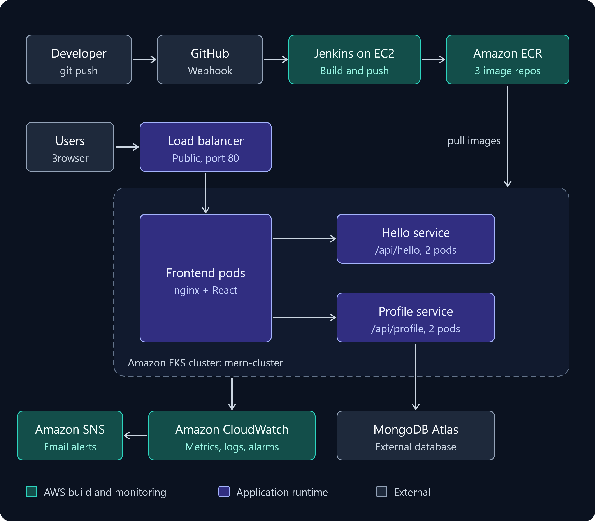


**How a request flows:** the browser loads the React app from the load balancer. The React code calls relative paths (`/api/hello/` and `/api/profile/...`). The nginx server inside the frontend container forwards those paths to the `hello-service` and `profile-service` Kubernetes services. The profile service reads and writes data in MongoDB Atlas.

**Components**

| Component | Folder | Port | Notes |
|---|---|---|---|
| Frontend (React + nginx) | `frontend/` | 80 | Public, behind an AWS load balancer |
| Hello service (Node.js) | `backend/helloService/` | 3001 | Internal, ClusterIP |
| Profile service (Node.js) | `backend/profileService/` | 3002 | Internal, needs `MONGO_URL` |
| Database | MongoDB Atlas | n/a | External, free cluster |

---

## 3. Tools and Technologies

| Area | Tool |
|---|---|
| Source control | Git, GitHub |
| Containers | Docker, Docker Desktop |
| Image registry | Amazon ECR |
| CI server | Jenkins on Amazon EC2 (Ubuntu) |
| Orchestration | Amazon EKS, kubectl, eksctl |
| Packaging | Helm |
| Monitoring and logging | Amazon CloudWatch (Container Insights, Logs, Alarms), Amazon SNS (alarm email) |
| Database | MongoDB Atlas |
| Region | ap-south-1 (Mumbai) for all resources |

---

## 4. Repository Structure

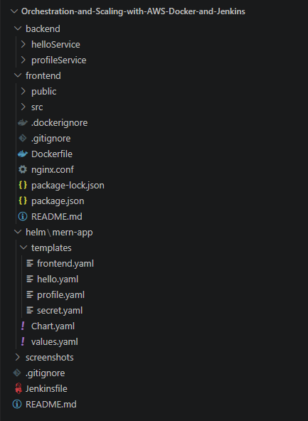 
---

## 5. Deployment Steps

### 5.1 Version Control with Git

1. Forked the main repository into my GitHub account (Fork, then Create fork).

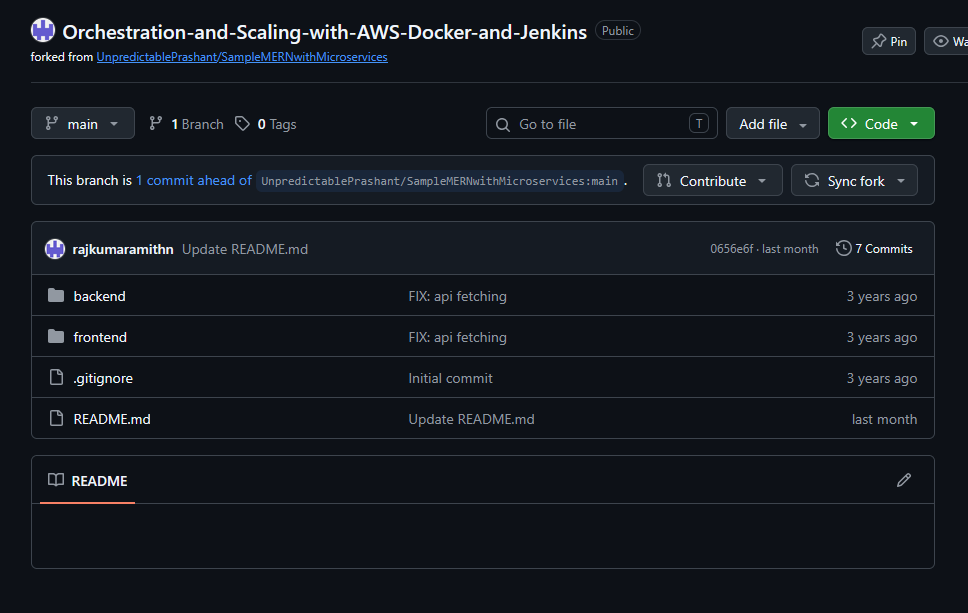

2. Cloned the fork and added the original repository as `upstream` so updates can be synced:

```bash
git clone https://github.com/rajkumaramithn/Orchestration-and-Scaling-with-AWS-Docker-and-Jenkins.git
cd Orchestration-and-Scaling-with-AWS-Docker-and-Jenkins
git remote add upstream https://github.com/UnpredictablePrashant/SampleMERNwithMicroservices.git
git remote -v
```

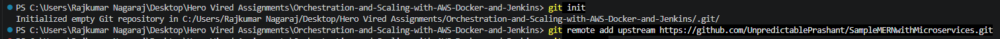

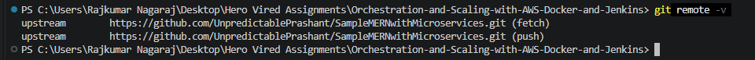


3. To sync updates from the main repository at any time:

```bash
git fetch upstream
git checkout main
git merge upstream/main
git push origin main
```

### 5.2 Containerizing the Application

**Frontend API change.** The original `frontend/src/components/Home.js` called `http://localhost:3001` and `http://localhost:3002`, which only work on a developer's laptop. The calls were changed to relative paths so the same code works locally and on AWS:

| Original | Changed to |
|---|---|
| `http://localhost:3001/` | `/api/hello/` |
| `http://localhost:3002/fetchUser` | `/api/profile/fetchUser` |

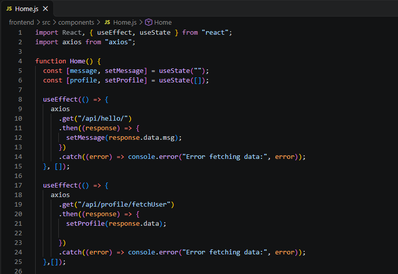

**Backend Dockerfile** (`backend/helloService/Dockerfile`; the profile service is identical except `EXPOSE 3002`):

```dockerfile
FROM node:18-alpine
WORKDIR /app
COPY package*.json ./
RUN npm ci --omit=dev
COPY . .
EXPOSE 3001
CMD node index.js
```

Each backend folder also has a `.dockerignore` containing `node_modules`, `.env` and `.git`.

**Frontend Dockerfile** (multi-stage: build with Node, serve with nginx):

```dockerfile
FROM node:18-alpine AS build
WORKDIR /app
COPY package*.json ./
RUN npm ci
COPY . .
ENV GENERATE_SOURCEMAP=false
RUN npm run build

FROM nginx:alpine
COPY --from=build /app/build /usr/share/nginx/html
COPY nginx.conf /etc/nginx/conf.d/default.conf
EXPOSE 80
```

**`frontend/nginx.conf`** (serves the React app and forwards API calls to the backend services):

```nginx
server {
  listen 80;
  root /usr/share/nginx/html;
  index index.html;

  location / {
    try_files $uri /index.html;
  }

  location /api/hello/ {
    proxy_pass http://hello-service:3001/;
  }

  location /api/profile/ {
    proxy_pass http://profile-service:3002/;
  }
}
```

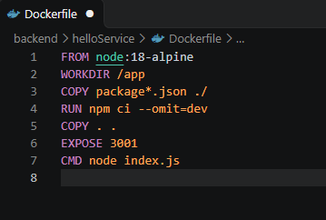

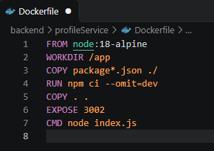

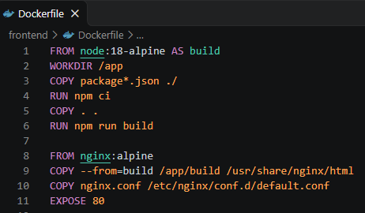

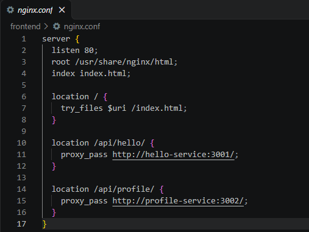


**Build and local test**

```powershell
docker build -t mern-hello-service ./backend/helloService
docker build -t mern-profile-service ./backend/profileService
docker build -t mern-frontend ./frontend

docker network create mern-net
docker run -d --name hello-service --network mern-net -e PORT=3001 mern-hello-service
docker run -d --name profile-service --network mern-net -e PORT=3002 -e MONGO_URL=$MONGO mern-profile-service
docker run -d --name frontend --network mern-net -p 3000:80 mern-frontend
```

`$MONGO` holds the MongoDB Atlas connection string (set in PowerShell with `$MONGO = '<ATLAS_STRING>'`). The connection string is never committed to the repository.

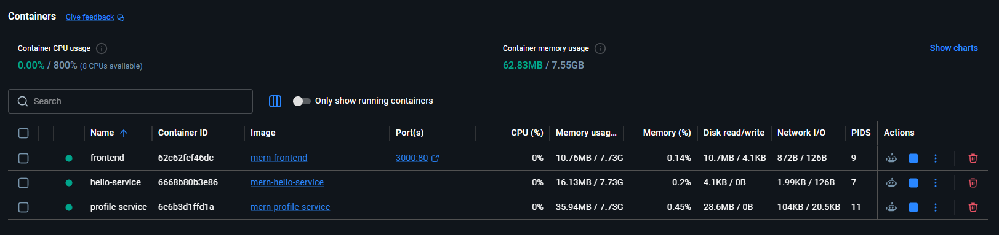

### 5.3 AWS Environment Setup

1. Created an IAM user `devops-admin` with the AdministratorAccess policy and generated an access key for the CLI. This is suitable for a learning project; use least-privilege permissions in production.

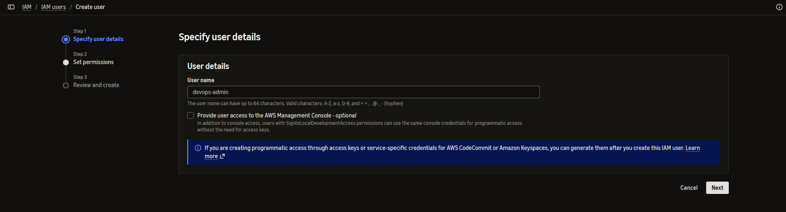

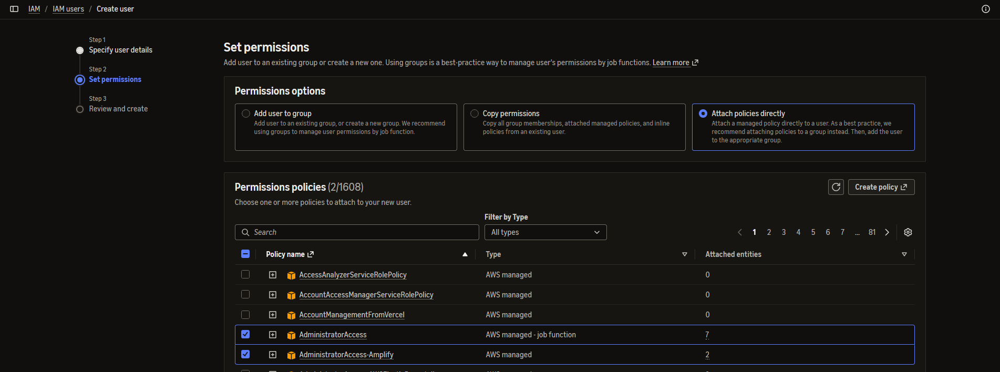

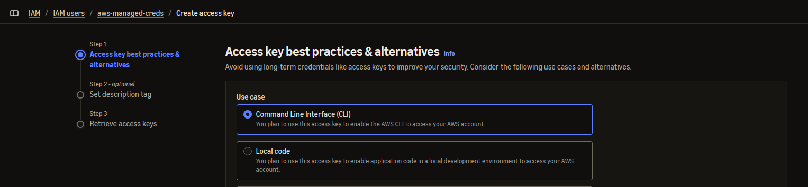

2. Installed the AWS CLI and configured it with `aws configure` (region `ap-south-1`, output `json`).
3. Verified the identity:

```bash
aws sts get-caller-identity
```
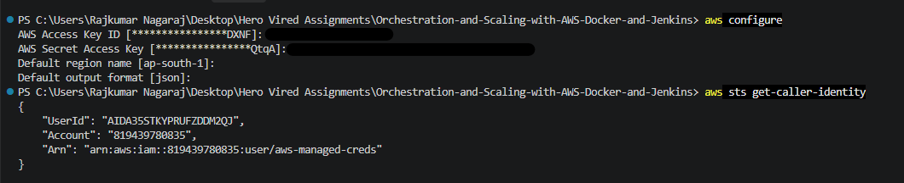

4. Installed kubectl, eksctl and Helm, and checked their versions.

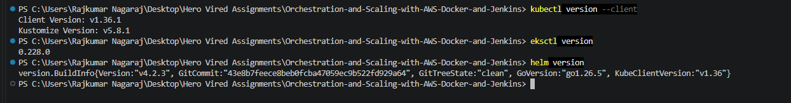

### 5.4 Pushing Images to Amazon ECR

Created one repository per component:

```bash
aws ecr create-repository --repository-name mern-frontend --region ap-south-1
aws ecr create-repository --repository-name mern-hello-service --region ap-south-1
aws ecr create-repository --repository-name mern-profile-service --region ap-south-1
```
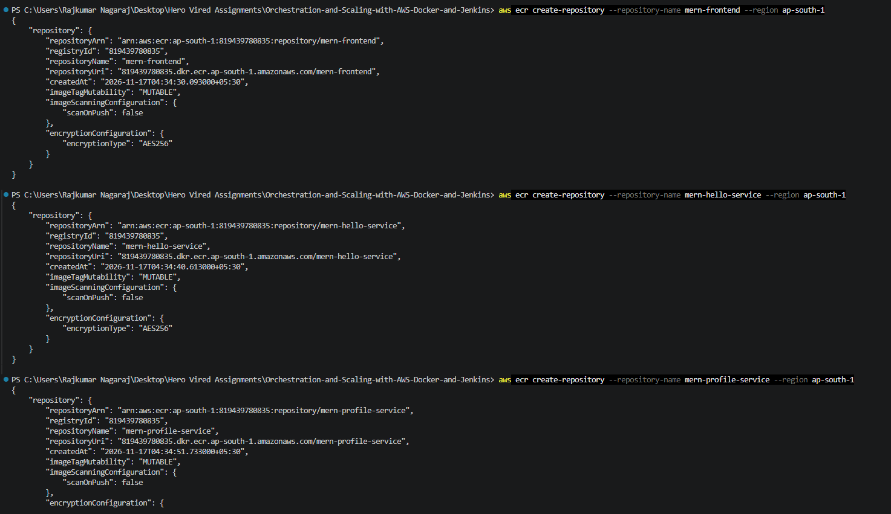

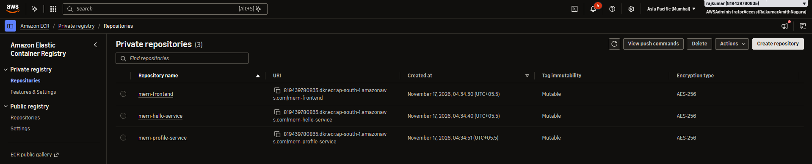

Logged Docker in to ECR, then tagged and pushed all three images:

```bash
aws ecr get-login-password --region ap-south-1 | docker login --username AWS --password-stdin <ACCOUNT_ID>.dkr.ecr.ap-south-1.amazonaws.com

docker tag mern-frontend:latest <ACCOUNT_ID>.dkr.ecr.ap-south-1.amazonaws.com/mern-frontend:latest
docker tag mern-hello-service:latest <ACCOUNT_ID>.dkr.ecr.ap-south-1.amazonaws.com/mern-hello-service:latest
docker tag mern-profile-service:latest <ACCOUNT_ID>.dkr.ecr.ap-south-1.amazonaws.com/mern-profile-service:latest

docker push <ACCOUNT_ID>.dkr.ecr.ap-south-1.amazonaws.com/mern-frontend:latest
docker push <ACCOUNT_ID>.dkr.ecr.ap-south-1.amazonaws.com/mern-hello-service:latest
docker push <ACCOUNT_ID>.dkr.ecr.ap-south-1.amazonaws.com/mern-profile-service:latest
```

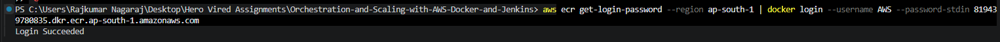

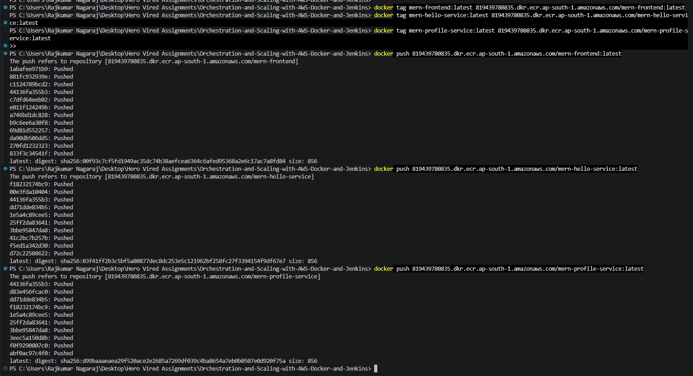


### 5.5 Continuous Integration with Jenkins

**Jenkins server on EC2**

1. Launched an EC2 instance in `ap-south-1`: name `jenkins-server`, Ubuntu Server, instance type `<t3.medium or the type you used>`, 20 GB storage, key pair `jenkins-key`. Security group inbound rules: SSH (22) from my IP, and TCP 8080 from anywhere (so GitHub can reach the webhook).

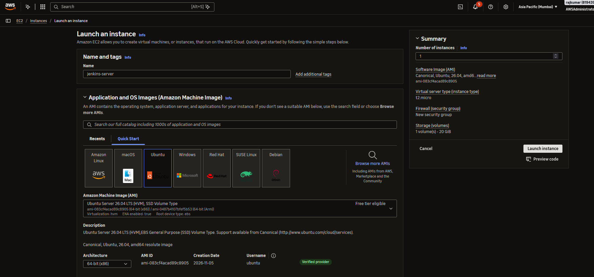

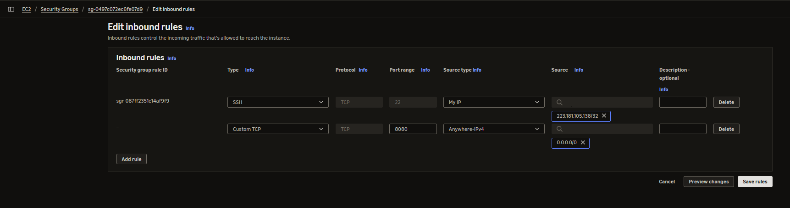

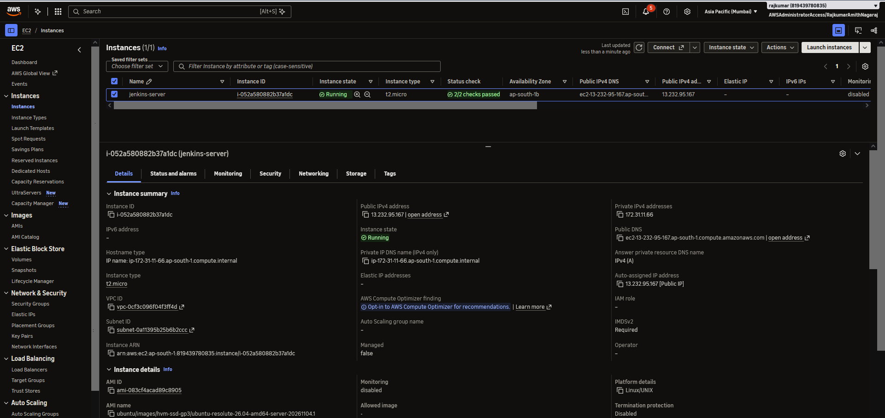


2. Created the IAM role `jenkins-ec2-role` with the policy AmazonEC2ContainerRegistryPowerUser and attached it to the instance. This lets Jenkins push to ECR without storing access keys on the server.

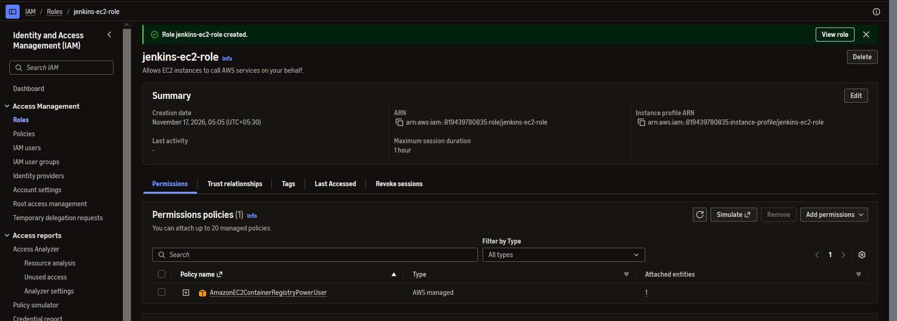


3. Connected over SSH and installed Java 21, Git, Docker, the AWS CLI and Jenkins (using the current Jenkins repository signing key). Gave the `jenkins` user access to Docker, and added a 2 GB swap file because the server has limited memory:

```bash
sudo apt install -y fontconfig openjdk-21-jre git docker.io unzip curl
sudo usermod -aG docker jenkins
sudo systemctl enable --now docker
sudo systemctl restart jenkins
```
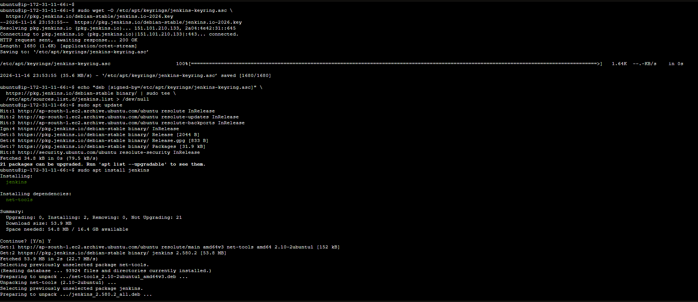

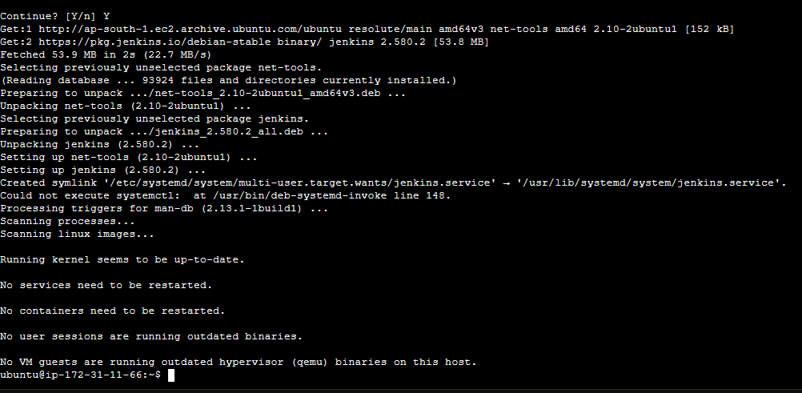

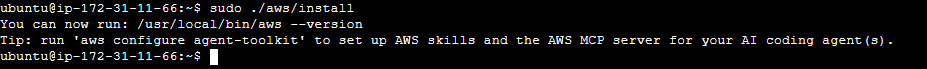

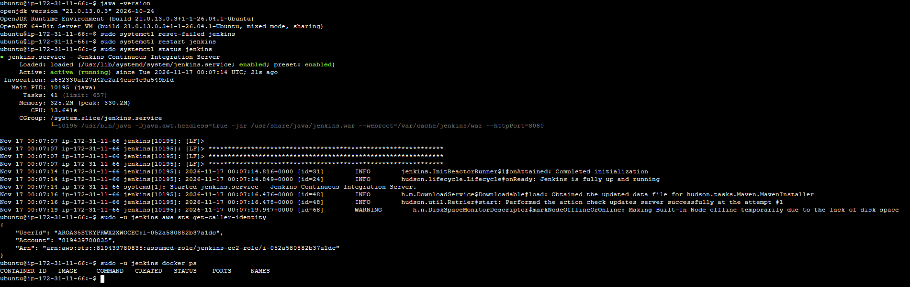

4. Opened `http://<EC2_PUBLIC_IP>:8080`, unlocked Jenkins with the initial admin password, installed the suggested plugins, and confirmed that the **GitHub** and **Docker Pipeline** plugins are installed (Manage Jenkins, Plugins, Installed plugins).

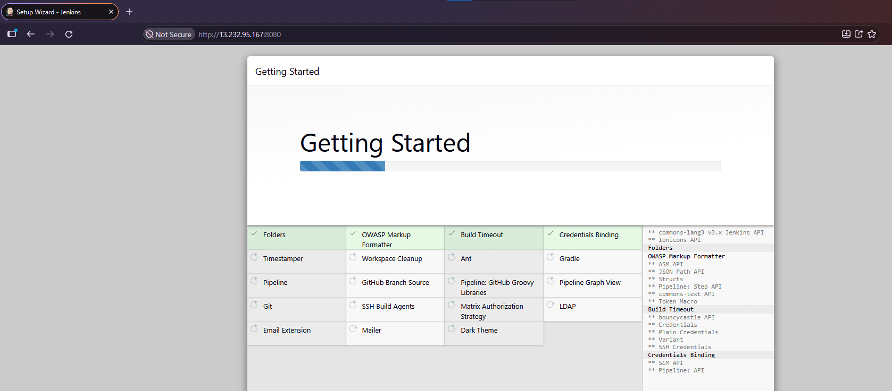

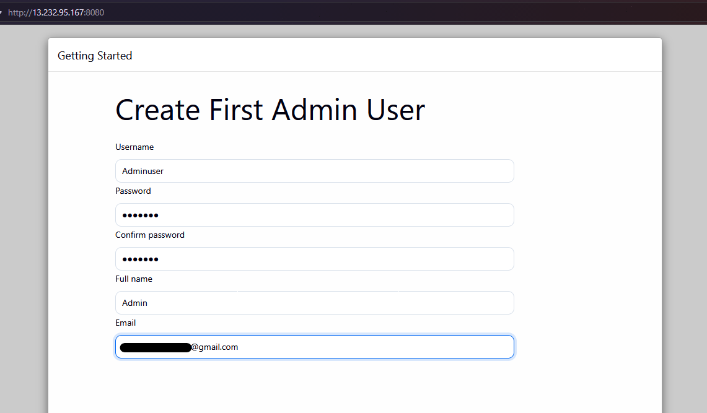

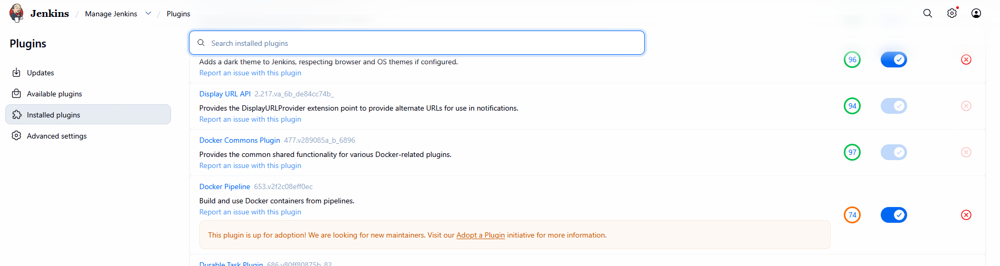

**The pipeline (`jenkinsfile` in the repository root)**

```groovy
pipeline {
  agent any
  environment {
    AWS_REGION = 'ap-south-1'
    ACCOUNT_ID = '<ACCOUNT_ID>'
    REGISTRY   = "${ACCOUNT_ID}.dkr.ecr.${AWS_REGION}.amazonaws.com"
    TAG        = "${BUILD_NUMBER}"
  }
  stages {
    stage('Checkout') {
      steps { checkout scm }
    }
    stage('ECR Login') {
      steps {
        sh 'aws ecr get-login-password --region $AWS_REGION | docker login --username AWS --password-stdin $REGISTRY'
      }
    }
    stage('Build Images') {
      steps {
        sh 'docker build -t $REGISTRY/mern-hello-service:$TAG -t $REGISTRY/mern-hello-service:latest ./backend/helloService'
        sh 'docker build -t $REGISTRY/mern-profile-service:$TAG -t $REGISTRY/mern-profile-service:latest ./backend/profileService'
        sh 'docker build -t $REGISTRY/mern-frontend:$TAG -t $REGISTRY/mern-frontend:latest ./frontend'
      }
    }
    stage('Push Images') {
      steps {
        sh 'docker push $REGISTRY/mern-hello-service --all-tags'
        sh 'docker push $REGISTRY/mern-profile-service --all-tags'
        sh 'docker push $REGISTRY/mern-frontend --all-tags'
      }
    }
  }
  post {
    always { sh 'docker image prune -f' }
  }
}
```

Each build tags the images twice: with the Jenkins build number (so every version can be traced and rolled back) and with `latest`.

**Pipeline job.** Created a Pipeline job named `mern-pipeline` with these settings:

- Build trigger: **GitHub hook trigger for GITScm polling**
- Definition: **Pipeline script from SCM**
- SCM: **Git**, with the repository URL of my fork
- Branch: `*/main`
- Script path: `jenkinsfile` (it must match the exact file name in the repository, including lower case)

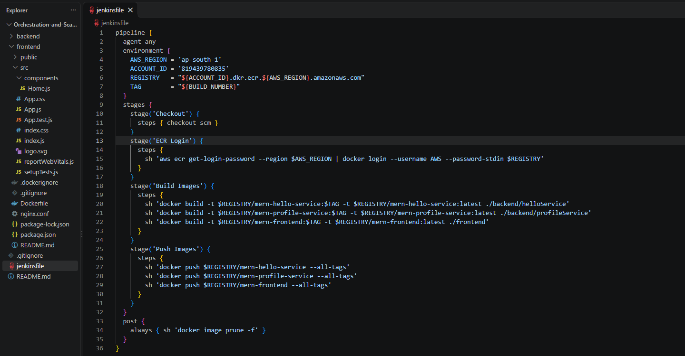

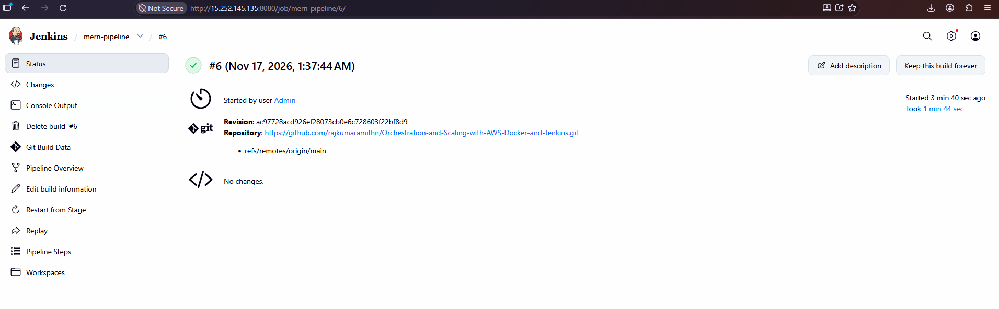

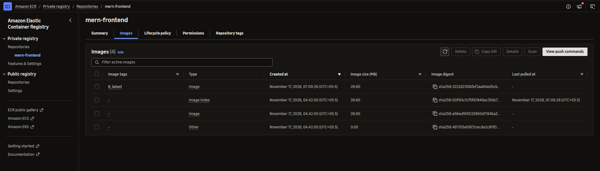

**Automatic builds with a GitHub webhook.** In the repository: Settings, Webhooks, Add webhook. Payload URL `http://<EC2_PUBLIC_IP>:8080/github-webhook/`, content type `application/json`, event: push only.

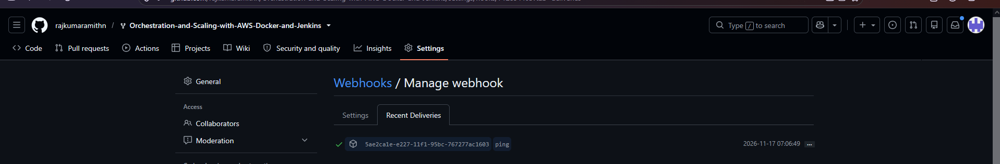


### 5.6 Creating the EKS Cluster

```bash
eksctl create cluster --name mern-cluster --region ap-south-1 --nodegroup-name workers --node-type t3.medium --nodes 2 --nodes-min 2 --nodes-max 4 --managed
kubectl get nodes
```

The cluster has a managed node group of 2 `t3.medium` nodes that can grow to 4. `eksctl` also installs the default add-ons (vpc-cni, kube-proxy, coredns and metrics-server).

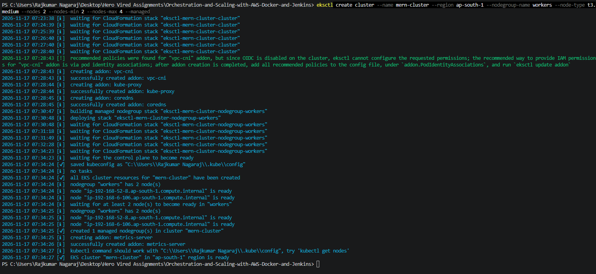

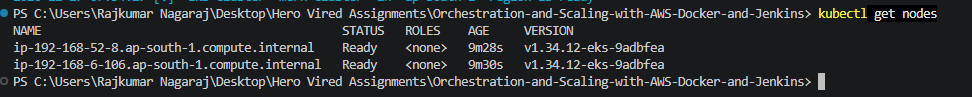


### 5.7 Deploying with Helm

The Helm chart lives in `helm/mern-app/` and contains one Deployment and one Service for each component, plus a Secret that holds the MongoDB connection string.

```
helm/mern-app/
  Chart.yaml
  values.yaml
  templates/
    secret.yaml     (MONGO_URL secret)
    hello.yaml      (Deployment + ClusterIP Service, port 3001, 2 replicas)
    profile.yaml    (Deployment + ClusterIP Service, port 3002, 2 replicas, reads the secret)
    frontend.yaml   (Deployment + LoadBalancer Service, port 80, 2 replicas)
```

`values.yaml`:

```yaml
registry: <ACCOUNT_ID>.dkr.ecr.ap-south-1.amazonaws.com
tag: latest
mongoUrl: ''
```

Design choices:

- Only the frontend is exposed to the internet (service type `LoadBalancer`). The two backends use `ClusterIP`, so they are reachable only inside the cluster.
- The Kubernetes service names (`hello-service`, `profile-service`) match the names used in `nginx.conf`, which is how the frontend finds the backends.
- The hello and profile services have readiness probes on `/health`, and every container has CPU and memory requests (required for autoscaling).
- The database connection string is passed at install time and stored as a Kubernetes Secret. It is not stored in Git.

📸 **Attach Screenshot 24:** the `helm/mern-app` folder tree in VS Code.

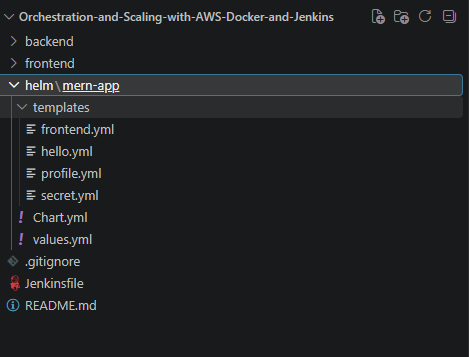

Deployment commands:

```bash
helm lint helm/mern-app
helm install mern helm/mern-app --set-string mongoUrl='<ATLAS_STRING>'
kubectl get pods
kubectl get svc
helm list
```

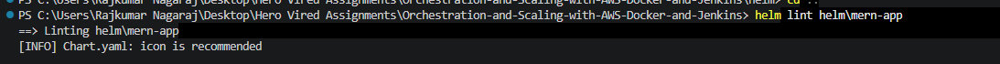

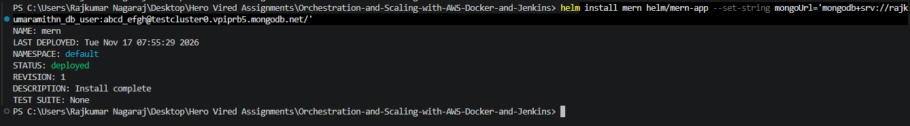

)

)


To roll out new images built by Jenkins:

```bash
kubectl rollout restart deployment frontend hello-service profile-service
```

### 5.8 Monitoring and Logging with Amazon CloudWatch

1. Attached the `CloudWatchAgentServerPolicy` policy to the EKS node group role, so the nodes can send data to CloudWatch.
2. Installed the CloudWatch Observability add-on:

```bash
aws eks create-addon --cluster-name mern-cluster --addon-name amazon-cloudwatch-observability --region ap-south-1
kubectl get pods -n amazon-cloudwatch
```

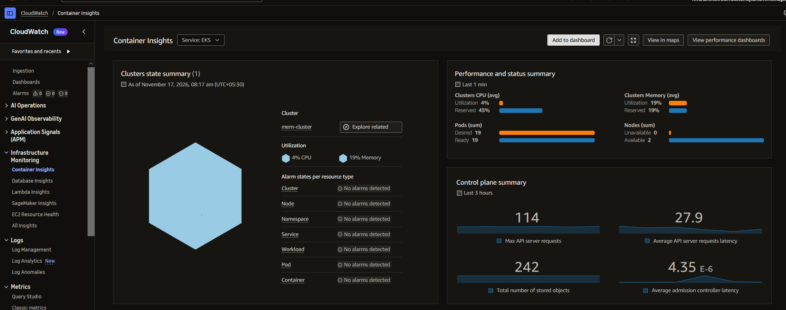

3. **Metrics:** CloudWatch, Container Insights, Performance monitoring, cluster `mern-cluster`. The dashboards have cluster, node, namespace, service, workload, pod and container views for CPU, memory and network.

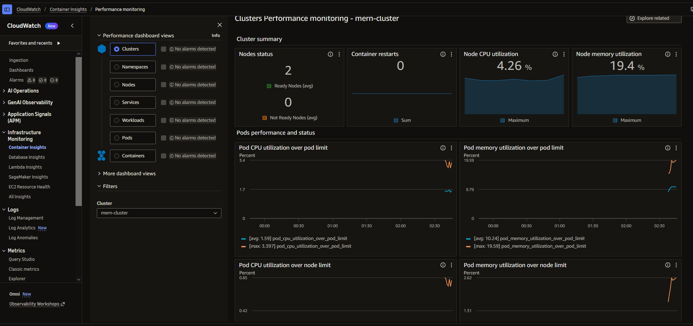

4. **Centralized logs:** CloudWatch, Logs, Log groups, `/aws/containerinsights/mern-cluster/application`. Logs from the frontend, hello and profile pods are collected here.

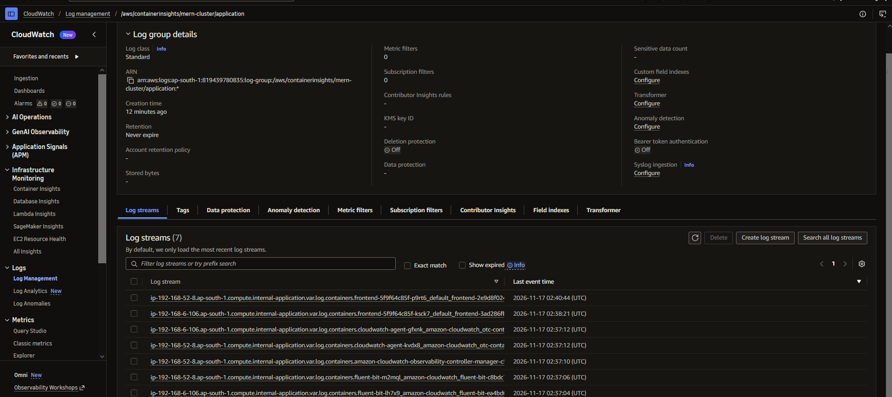

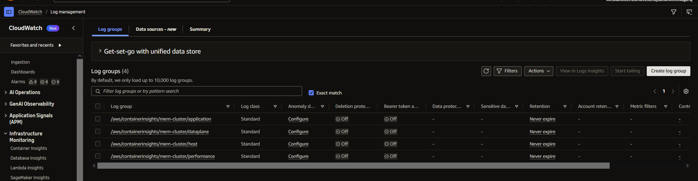

5. **Alarm:** created the alarm `mern-high-cpu` on the metric `node_cpu_utilization` (static threshold, greater than 70). It notifies the SNS topic `mern-alerts`, which sends an email to my address.

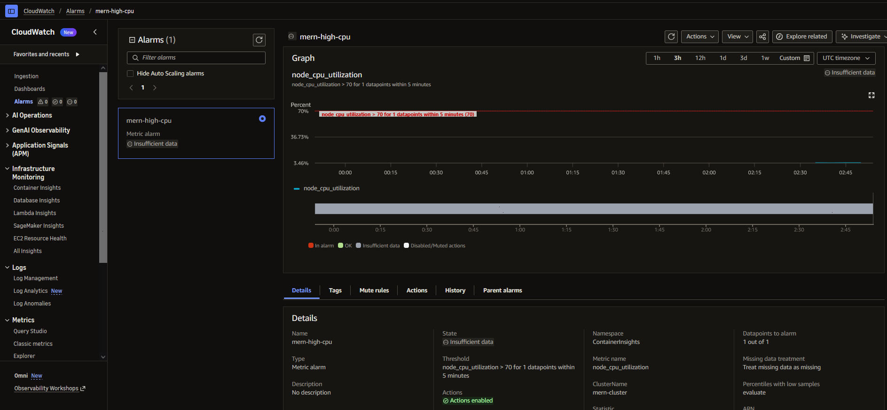

6. **Dashboard:** created a CloudWatch dashboard with node CPU and memory widgets.

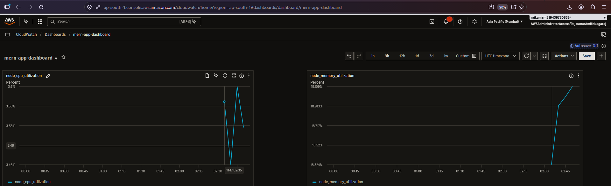

### 5.9 Final Validation

**Frontend:** the page loads from the load balancer URL and shows the welcome text and the Hello message.

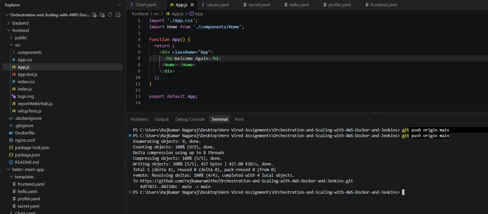

Automated Build Started

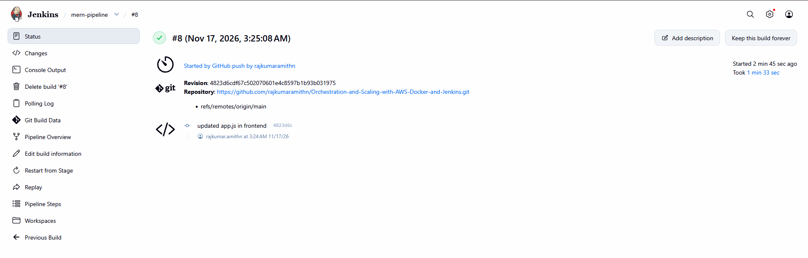\

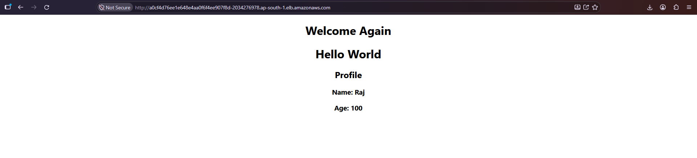

**Backend and database:** added a user through the load balancer, refreshed the page to see it listed, and confirmed that the record exists in MongoDB Atlas.

```powershell
Invoke-RestMethod -Method Post -Uri 'http://<EXTERNAL-IP>/api/profile/addUser' -ContentType 'application/json' -Body '{"name":"Raj","age":100}'
```


**Health check:**

```bash
kubectl get pods
kubectl get svc
kubectl logs deployment/profile-service
kubectl logs deployment/hello-service
```

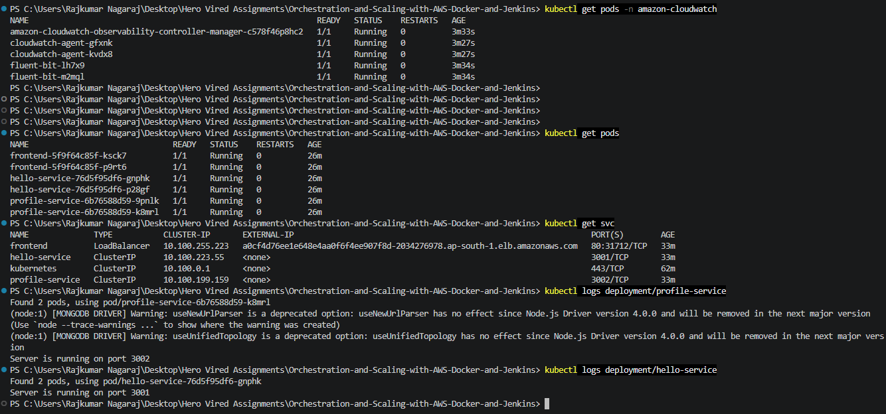

**Manual scaling:**

```bash
kubectl scale deployment profile-service --replicas=4
kubectl get pods
```


**Autoscaling (Horizontal Pod Autoscaler).** `metrics-server` was already installed by `eksctl`, so only the autoscaler was created:

```bash
kubectl autoscale deployment profile-service --cpu-percent=70 --min=2 --max=5
kubectl get hpa
```


**End-to-end CI/CD test:** changed the frontend text, committed and pushed. Jenkins built and pushed new images automatically, then the frontend deployment was restarted and the change appeared in the browser.


---

## 6. How to Access the Application

| Item | Value |
|---|---|
| Application URL | `http://<LOAD_BALANCER_ADDRESS>` (the EXTERNAL-IP of the `frontend` service) |
| Jenkins | `http://<EC2_PUBLIC_IP>:8080` (the IP changes if the instance is stopped and started) |
| Region | `ap-south-1` |

---

## 7. Challenges and Fixes

| Problem | Cause | Fix |
|---|---|---|
| `flag needs an argument: 'e' in -e` when running the profile service | The Docker command was cut off before the connection string | Saved the string in a PowerShell variable and ran the command on one line |
| `curl` failed in PowerShell | PowerShell's `curl` is an alias for `Invoke-WebRequest` | Used `Invoke-RestMethod` |
| Jenkins repository error `NO_PUBKEY` | Jenkins rotated its signing key | Downloaded the current key and re-ran `apt update` |
| Jenkins would not start | Java 17 was installed, but current Jenkins needs Java 21 | Installed `openjdk-21-jre` and selected it |
| Build waited for an executor, node offline | The server had no swap and almost no free memory | Created a 2 GB swap file (made permanent in `/etc/fstab`) and brought the node online |
| `Unable to find Jenkinsfile` | The file in the repository is `jenkinsfile` (lower case) | Set the job's script path to `jenkinsfile` |
| Build too slow on a free-tier server | 1 GB RAM is too small for Docker and npm builds | Moved Jenkins to a larger instance type |
| EKS cluster started in the wrong region | The command used `us-east-1` while ECR and Jenkins are in `ap-south-1` | Cancelled, deleted the partial stack and recreated it in `ap-south-1` |
| `helm lint` could not find `Chart.yaml` | Files were saved with the `.yml` extension | Renamed them to `.yaml` |
| `--role-name` invalid in `aws iam attach-role-policy` | The full ARN was used | Used only the role name |
| metrics-server `Duplicate value` and `immutable` errors | `eksctl` had already installed metrics-server | Skipped the extra install and created only the HPA |

---

## 8. Clean-up

To avoid AWS charges, remove the resources when the project is finished:

```bash
helm uninstall mern
eksctl delete cluster --name mern-cluster --region ap-south-1
```

Then, in the AWS Console:

1. Terminate the Jenkins EC2 instance.
2. Delete the three ECR repositories.
3. Delete the CloudWatch alarm, dashboard and log groups.
4. Delete the SNS topic `mern-alerts`.
5. Delete the CLI user's access keys.
6. Check Billing the next day to confirm nothing is still running.

---

## 9. Conclusion

The application now builds automatically on every commit, is stored as versioned images in ECR, runs on a scalable Kubernetes cluster with load balancing, and is monitored with centralized metrics, logs and alarms.

Note: Please refer to screenshots directory for more documentation evicdence.
